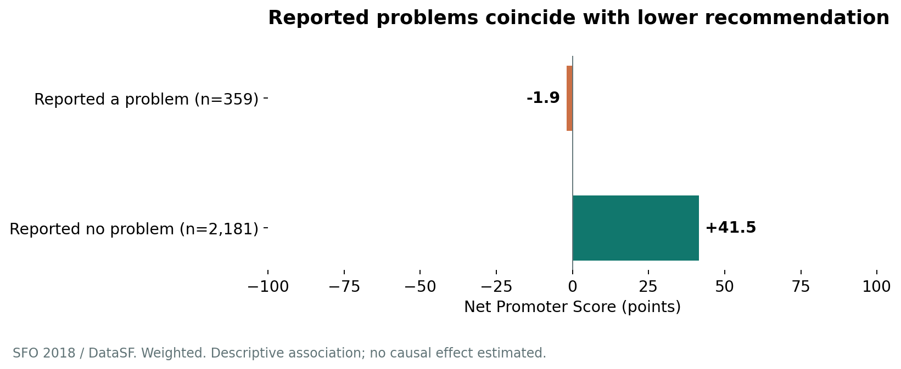

# Passenger experience at SFO

**A reproducible Python customer experience case study using the 2018 SFO survey.**

Reported problems coincide with a 43.4-point NPS gap. Meanwhile, 80.5% of
valid respondents rate the airport 4 or 5 out of 5. This project examines that
contrast, compares service ratings and coded problem themes, and checks how
service usage changes the interpretation.

## Business question

Which parts of the passenger experience deserve follow-up, and how do
reported problems relate to willingness to recommend SFO?

| Measure | Weighted result | Actual valid n |
| --- | ---: | ---: |
| Overall airport rating 4 or 5 | 80.5% | 2,625 |
| Net Promoter Score | +35.1 points | 2,650 |
| Reported a problem | 12.9% | 2,616 |
| NPS among problem reporters | -1.9 points | 359 |
| NPS among people reporting no problem | +41.5 points | 2,181 |

Source: San Francisco International Airport / DataSF, 2018 survey. All figures
are independent weighted calculations. This is historical evidence, not a
claim about current airport performance or a causal estimate of problem impact.



## Start here

1. Read [the survey guide](docs/survey_guide.md).
2. Open [the executed notebook](notebooks/01_sfo_customer_experience.ipynb).
3. Read [the full case study](reports/case_study.md).
4. Review [the LinkedIn carousel](presentation/sfo_2018_linkedin_carousel.pdf)
   and [caption draft](presentation/linkedin_caption.md).

## Reproduce from a clean checkout

Python 3.11 or later is required. From the project root:

```bash
python -m venv .venv
# Activate the virtual environment for your operating system.
python -m pip install -r requirements.txt
python scripts/run_analysis.py
python -m unittest discover -s tests -v
```

Activate with `source .venv/bin/activate` on macOS/Linux or
`.venv\Scripts\Activate.ps1` in Windows PowerShell.

The first run downloads both public DataSF files, verifies their checksums,
and rebuilds the tables, figures, written report, executed notebook and PDF.
Raw source data are excluded from the release ZIP and from version control.

If automatic retrieval fails, download the [CSV](https://data.sf.gov/api/views/3w8r-nuxp/rows.csv?accessType=DOWNLOAD)
and [dictionary](https://data.sf.gov/download/wkh6-n369/application/vnd.openxmlformats-officedocument.spreadsheetml.sheet)
manually. Place them in `data/raw/` using these exact names:

- `2018_SFO_Customer_Survey.csv`
- `sfo_2018_Data_Dictionary_DataSF.xlsx`

Your originally supplied `2018_SFO_Customer_Survey_20261020.csv` can be copied
and renamed to the first name above. The script accepts the verified uploaded
and public-export byte hashes. If source bytes change, the build stops for
review rather than silently using a different dataset.

For interactive exploration:

```bash
python -m pip install -r requirements-notebook.txt
jupyter lab
```

Open the notebook from the project root or `notebooks/` directory. Its charts
are created by the analysis command and included in this package.

## What is in the project?

| Folder or file | Purpose |
| --- | --- |
| `src/sfo_cx/analysis.py` | Cleaning flags, NPS, weighting, grouping and sensitivity |
| `scripts/download_data.py` | Retrieve and verify original sources |
| `scripts/run_analysis.py` | One-command full rebuild |
| `scripts/build_outputs.py` | Figures, dictionaries, executed notebook, report and PDF |
| `notebooks/` | Guided analysis with real executed outputs |
| `outputs/tables/` | Full-precision metrics, subgroup results and audit JSON |
| `outputs/figures/` | PNG and SVG charts |
| `docs/` | Survey guide, dictionaries, validation and GitHub/editing instructions |
| `reports/case_study_template.md` | Editable report text that survives rebuilds |
| `reports/case_study.md` | Generated full report |
| `presentation/carousel_content.json` | Editable slide wording that survives rebuilds |
| `presentation/` | Generated 10-page PDF, extracted text and caption draft |
| `tests/` | Synthetic survey-logic and original-source regression checks |

## Analytical choices

- Explicit bases for every question; valid scores differ between ratings and NPS.
- Nullable outcomes preserve unknown and not-applicable answers.
- Weighted estimates alongside actual response counts and unweighted sensitivity.
- One person per problem theme, even when several codes map to that theme.
- Usage sensitivity for Wi-Fi, restaurants and retail.
- Boarding-area standardization of the NPS comparison as an exploratory check.
- Pairwise unweighted Spearman correlations labelled as descriptive co-ratings.
- No formal significance tests, causal driver claims or ROI forecasts.

## Edit wording and upload to GitHub

You can edit README and documentation Markdown directly on GitHub. For text
that a rebuild generates, edit **the source template**: report text in
`reports/case_study_template.md` and slide text in
`presentation/carousel_content.json`. Rerun the analysis to update the report
and PDF. Numeric placeholders draw from actual results.

See [editing and publishing instructions](docs/editing_and_github.md).
Suggested repository name: `sfo-2018-customer-experience`.

## Sources and attribution

- [DataSF survey listing](https://data.sf.gov/Transportation/2018-SFO-Customer-Survey/3w8r-nuxp)
- [Official CSV](https://data.sf.gov/api/views/3w8r-nuxp/rows.csv?accessType=DOWNLOAD)
- [Official dictionary](https://data.sf.gov/download/wkh6-n369/application/vnd.openxmlformats-officedocument.spreadsheetml.sheet)
- [Dictionary catalogue](https://catalog.data.gov/dataset/2018-sfo-customer-survey-data-dictionary)

Data source: San Francisco International Airport / DataSF. The survey listing
identifies an Open Data Commons Public Domain Dedication and License. All
outputs are independent calculations, with source attribution retained.
No SFO or DataSF endorsement is implied.
